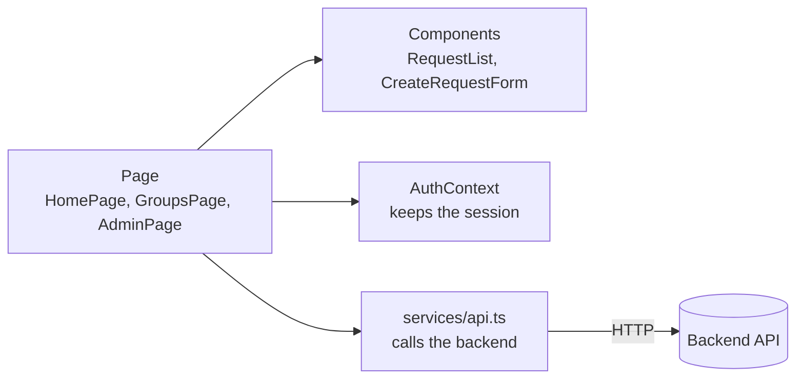
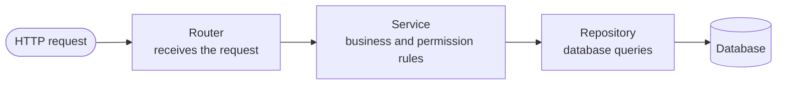

# CampusFix

A campus service request system for students and staff: students report maintenance and service issues and track them, authorized staff work on assigned requests, and administrators manage users and monitor security. Requests can also be handled in shared groups with per-member permissions. Built as a REST API with FastAPI and a React frontend, deployed on Vercel.

> **Status:** Final submission for CSE309 (Autumn 2026). Sign up and log in, private requests, a profile page with sessions, shared groups with permissions, an admin dashboard with audit log and security view, login rate limiting, and deployment on Vercel are built. Some planned features are **not** finished: see [Not implemented](#not-implemented) and the Limitations section of the [final report](docs/FINAL_REPORT.md).

## Live links

| Item | Link |
|---|---|
| Live application | https://2310626.vercel.app |
| Backend API | https://2310626.vercel.app/api |
| API documentation (Swagger) | https://2310626.vercel.app/api/docs |
| Health check | https://2310626.vercel.app/api/health |
| Demo video | https://youtu.be/PFrniyyMCHo |
| GitHub repository | https://github.com/Sahkib159/2310626-CampusFix |

## Features

**MVP** (demo before mid-term)
- Create, list, view, update, delete and assign service requests through a REST API (`/api/requests`)
- Input validation with clear error responses
- Interactive API docs at `/api/docs`

**Final** (demo before final)
- Sign up, log in, log out (JWT access token + refresh token cookie)
- Personal requests: each student sees only their own; search by title, description or request ID
- Profile page: change your name and password, see and revoke your sessions
- Groups: create a group, add members, share and assign requests
- Roles: `STUDENT`, `STAFF` and `ADMIN`, enforced on the server
- Group permissions: the owner chooses what each member may do (create, edit, assign requests); only the owner can manage members, rename, archive and delete the group
- Admin dashboard: statistics, user search with role and status filters and pagination, user detail (groups, sessions, recent activity), ban / unban with a reason, role change, session revoke, bulk ban / unban, group list and delete (single and bulk)
- Audit log and security view: every important admin and login event is recorded, filterable, exportable as CSV, and failed logins are shown by IP and by account
- Safety rules: an admin cannot change their own role or another admin's role; a banned user is rejected on the next request
- Security: Argon2 password hashing with a server-side pepper, hashed rotating refresh tokens, login rate limiting by account and IP

### Not implemented

Category administration, student cancellation, resolution notes, an enforced request status lifecycle, admin-wide request moderation, CSV exports of users and requests, and some dashboard metrics (for example, items created in the last 7 days). Details are in the [final report](docs/FINAL_REPORT.md).

## Tech stack

| Part | Choice |
|---|---|
| Backend | Python, FastAPI, SQLModel |
| Database | PostgreSQL-compatible hosted database |
| Frontend | React 19 + TypeScript + Vite |
| Hosting | Vercel (frontend and backend in one project) |
| Extras | Alembic (migrations), PyJWT, pwdlib (Argon2), pytest |

## Documentation

| Doc | What it covers |
|---|---|
| [Final report](docs/FINAL_REPORT.md) | The finished project: requirements, design, testing, limitations. **Start here.** |
| [PRD](docs/01-prd.md) | Original product requirements (planning document) |
| [SRS](docs/02-srs.md) | Original software requirements (planning document) |
| [TDD](docs/03-tdd.md) | Original technical design (planning document) |

The PRD, SRS and TDD were written before the work and may list features that were not delivered. The final report describes what actually exists.

## Project structure

```
backend/    FastAPI app (routes under /api), Alembic migrations, scripts, tests
frontend/   Vite + React + TypeScript
docs/       Final report, PRD, SRS, TDD
vercel.json Vercel setup: /api/* goes to the backend, everything else to the frontend
```

## How it works

### Frontend



A page shows the screen and keeps its data, components draw the pieces, `AuthContext` holds the logged-in user, and `services/api.ts` is the only place that talks to the backend.

### Backend



Each feature (`auth`, `admin`, `audit`, `groups`, `service_requests`) has the same layers: the router handles HTTP, the service decides what is allowed (ownership, group permissions, admin rules), and the repository reads and writes the database. The response goes back up the same way.

### Logging in

```mermaid
flowchart LR
    login["Log in<br/>email and password"] --> tokens["Server answers with<br/>access token + refresh cookie"]
    tokens --> call["Every request sends<br/>Authorization: Bearer token"]
    call --> me["Server checks the token, the user<br/>and the role, then answers"]
```

The access token (15 minutes or less) is kept in memory only, never in `localStorage`, and sent with each request. The refresh token (7 days by default) is a random value in an `HttpOnly` cookie, stored hashed on the server. When the access token expires, `services/api.ts` swaps it for a new one once and retries; if that fails you are logged out. On every protected request the server also checks the real user, role and ban state in the database.

## Requirements

- Git
- Python (a version compatible with the dependencies in `backend/requirements.txt`)
- Node.js and npm
- A PostgreSQL database (or any compatible database URL)

> On macOS/Linux, use `python3` instead of `python`.

## Run locally

You need two terminals: one for the backend and one for the frontend.

### First time (initial setup)

**Backend** (terminal 1):

```powershell
git clone https://github.com/Sahkib159/2310626-CampusFix.git
cd 2310626-CampusFix
python -m venv .venv
.\.venv\Scripts\Activate.ps1     # macOS/Linux: source .venv/bin/activate
cd backend
pip install -r requirements.txt
Copy-Item .env.example .env      # macOS/Linux: cp .env.example .env
```

Edit `backend/.env` and set the variables in [Environment variables](#environment-variables). Then:

```powershell
alembic upgrade head             # creates the database tables
uvicorn main:app --reload
```

**Frontend** (terminal 2, from the repository root):

```powershell
cd frontend
npm install
npm run dev
```

Open the local URL that Vite prints in the terminal. The backend runs on `http://127.0.0.1:8000` with its routes under `/api`, and its docs are at `/api/docs`.

### Running again

Activate the virtual environment and run `uvicorn main:app --reload` in `backend/`, and `npm run dev` in `frontend/`. Run `alembic upgrade head` again only after pulling a change that adds a migration, and `pip install -r requirements.txt` or `npm install` only when a dependency changed.

### Run the tests

```powershell
# Backend (from the repository root); the tests use an in-memory database and test-only secrets
$env:DATABASE_URL = "sqlite://"
$env:JWT_SECRET_KEY = "test-only-secret-key-at-least-32-bytes"
$env:PASSWORD_PEPPER = "test-only-pepper-at-least-32-bytes"
cd backend
..\.venv\Scripts\python.exe -m pytest -vv -p no:cacheprovider tests

# Frontend type check and production build
cd ..\frontend
npm run build
```

The frontend has no automated test script.

### Changing the database (migrations)

Tables are created and changed by Alembic migrations in `backend/migrations/`. Run `alembic upgrade head` from `backend/` to apply them.

> The migration chain has not been validated against a completely empty database (see Limitations in the final report). If it fails on a fresh database, tell the author.

### Making someone an admin or staff

Everyone who signs up becomes a `STUDENT`. `STAFF` and `ADMIN` accounts are created with the scripts in `backend/scripts/`. Admins can change a user between `STUDENT` and `STAFF` from the admin page, but cannot change another admin's role.

### Sessions, groups and the audit log

- **Sessions** are listed on the profile page (`/api/auth/sessions`) and can be revoked one by one. Admins can revoke a user's session family. A revoked session cannot renew its access token, but an access token that was already issued stays valid until it expires.
- **Group permissions** are stored per member in the database, not in the JWT, so the owner's change applies on the next request. The owner always has create, edit and assign.
- **Audit events** include login, failed login, logout, `USER_BANNED`, `USER_UNBANNED`, `USER_ROLE_CHANGED`, `USER_SESSION_REVOKED`, `GROUP_DELETED` and `AUDIT_LOG_EXPORTED`. Admins see them under **Admin → Audit Logs**, and failed logins by IP and account under **Admin → Security**.
- **Exports** are CSV files of the audit log that respect the current filters, capped at 10,000 rows, with cells that start with `=`, `+`, `-` or `@` escaped.
- **Login limits:** repeated failed logins for the same account or IP are rejected with HTTP 429 for a 15-minute window.

## Test accounts for the instructor

These are demo accounts with demo data only. **Passwords are not stored in this repository.** They are in the submission form and the PDF report.

| User ID (email) | Role |
|---|---|
| admin@gmail.com | ADMIN |
| neymarjr@goat.com | ADMIN |
| shikamaru@gmail.com | STAFF |
| ronaldo@worldcup.com | STUDENT |
| test@gamil.com | STUDENT |

**Shared group with mixed permissions:** `CampusFix Test Group.` (owner: `admin@gmail.com`)

| Member | Create | Edit | Assign |
|---|---|---|---|
| admin@gmail.com (owner) | Yes | Yes | Yes |
| ahad@gmail.com | Yes | No | No |
| shikamaru@gmail.com | Yes | Yes | No |
| ronaldo@worldcup.com | Yes | Yes | Yes |

## Environment variables

In production (Vercel) set these under **Project → Settings → Environment Variables**. Locally put them in `backend/.env`. A real `.env` is never committed; `backend/.env.example` shows the names.

| Variable | Notes |
|---|---|
| `DATABASE_URL` | Connection string of the hosted PostgreSQL database. Required. Vercel cannot keep a local database file between requests, so a hosted database is needed for the data to persist. |
| `JWT_SECRET_KEY` | Long random string used to sign access tokens, e.g. `python -c "import secrets; print(secrets.token_urlsafe(48))"`. Required. |
| `PASSWORD_PEPPER` | A different long random string, mixed into every password before hashing so a leaked database alone cannot be cracked. Required. Never change it once users exist, or their passwords stop working. |
| `ACCESS_TOKEN_EXPIRE_MINUTES` | Access-token lifetime, between 1 and 15. Default 15. |
| `REFRESH_TOKEN_EXPIRE_DAYS` | Refresh-token lifetime. Default 7. |
| `COOKIE_SECURE` | `true` in production (HTTPS only), `false` for local HTTP. |
| `COOKIE_SAMESITE` | SameSite policy of the refresh cookie. |

Never commit secrets or `.env` files.

## Deploy to Vercel

1. Push the repo to GitHub.
2. Import the repo at https://vercel.com/new and deploy. `vercel.json` sends `/api/(.*)` to the FastAPI backend and everything else to the frontend.
3. Add the environment variables from the table above.
4. Run `alembic upgrade head` against the hosted database from your machine **before** merging code that needs a new schema.
5. Smoke test the production URL: check `/api/health` and `/api/docs`, sign up, log in, create a request, create a group and add a member, then open the admin page with an admin account.

Every push to the connected branch (`main`) redeploys automatically. A successful preview deployment does not mean production was updated, so check the production deployment and its commit separately.

## Contributing

Every change starts from a GitHub issue:

1. Create an issue describing the task.
2. Create a branch for the issue.
3. Make the change and test it.
4. Commit with a descriptive message.
5. Open a pull request targeting `main` with `Closes #{issue_number}` in the description.
6. Review and merge.

## Troubleshooting

- **"Running scripts is disabled" in PowerShell:** run `Set-ExecutionPolicy -Scope CurrentUser RemoteSigned`.
- **`uvicorn` not found or `ModuleNotFoundError`:** activate the virtual environment, then run `pip install -r requirements.txt`.
- **`no such table` or `Request failed: 500` right after pulling:** run `alembic upgrade head` in `backend/`.
- **`Request failed: 500` in the app:** the backend is not running, or `DATABASE_URL` is wrong.
- **Everything redirects to the login page:** log in or sign up first.
- **Login returns 429:** too many failed attempts for that account or IP; wait 15 minutes.
- **A banned account cannot log in:** an admin has to unban it from the admin page.
- **Vercel build fails:** check **Build Logs** in the Vercel dashboard, and make sure `npm run build` works in `frontend/`.

## Academic project

CampusFix is an academic software engineering project for Independent University, Bangladesh (IUB), CSE309 Web Application & Internet, Autumn 2026. Student: Sahkib Ahad Chowdhury (ID 2310626, Section 06).